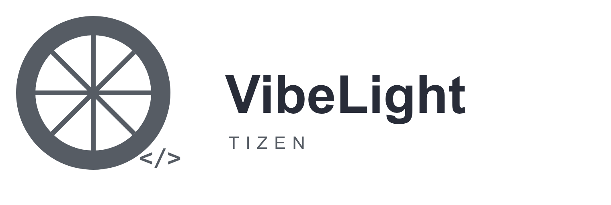
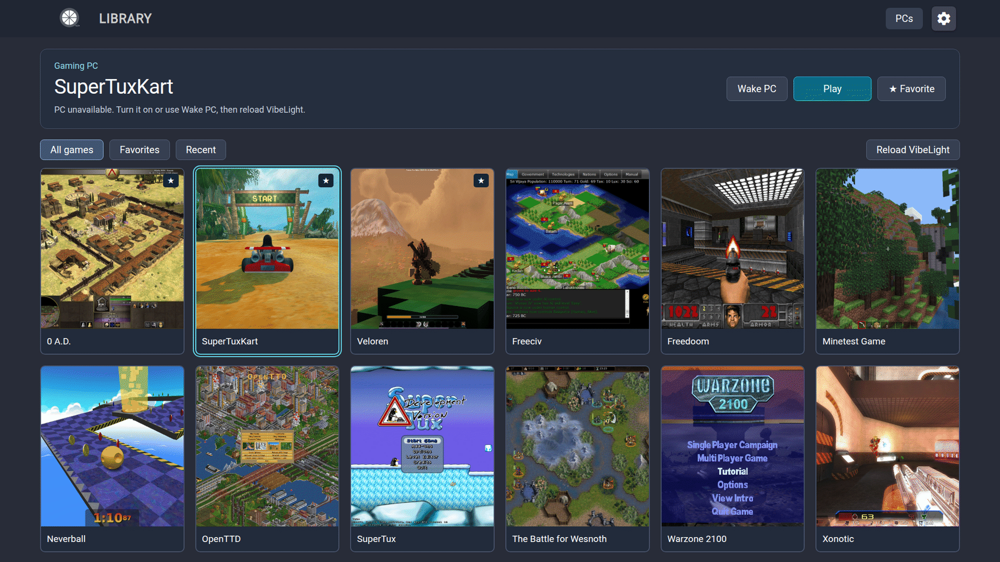

<p align="center">
  <picture>
    <source media="(prefers-color-scheme: dark)" srcset="docs/images/vibelight-logo.png">
    <source media="(prefers-color-scheme: light)" srcset="docs/images/vibelight-logo-light.png">
    
  </picture>
</p>

**VibeLight-Tizen** is a vibe-coded **fork of Moonlight Tizen** for Samsung Smart TVs, based on [BrightCraft's client](https://github.com/brightcraft/moonlight-tizen). Developed with AI assistance and maintained independently.

Stream PC games through [Sunshine](https://app.lizardbyte.dev/Sunshine/) or NVIDIA GameStream. The goal: keep improving VibeLight on Tizen OS toward a **console-like experience**, with **smoother gameplay, low latency and full picture quality**.

---

## Interface



Local UI demonstration with simulated PC states and openly licensed game images;
see [image credits and licenses](docs/images/ATTRIBUTION.md).

---

## Installation and quick start

You need a Samsung TV running **Tizen 5.5 or newer** and a PC running Sunshine.
Keep the TV, PC and installation device on the same local network.

Choose the build that suits your TV:

- **Normal:** does not request TV panel Game Mode.
- **ForceGM:** requests TV panel Game Mode; behavior depends on the TV and firmware.

The in-app *Game Mode* switch is separate; see the FAQ below.

1. **Download VibeLight.** Get a `.wgt` from the
   [latest release](https://github.com/samirmartins/vibelight-tizen/releases/latest).
2. **Install on the TV.** Enable the TV's Developer Mode and install the downloaded
   widget with Apps2Samsung, following the
   [Installation Guide](INSTALLATION.md#apps2samsung-recommended).
3. **Set up Sunshine on the PC.** Follow Sunshine's
   [Getting Started guide](https://docs.lizardbyte.dev/projects/sunshine/latest/md_docs_2getting__started.html),
   open its web interface, and add your games under **Applications**.
   You can use **Desktop** for the first connection. Keep Sunshine running.
4. **Add and pair the PC.** Open VibeLight on the TV and select your PC from **PCs**.
   If it is not listed, choose **Add Host** and enter the PC's local IP address.
   Enter the PIN shown on the TV in Sunshine's **PIN** page on the PC to complete pairing.
5. **Start playing.** Connect a gamepad to the TV, select a game or **Desktop**
   in the library, and choose **Play**. Use **Resume** to reconnect to an
   application that is already running.

---

## What VibeLight offers

- **Video:** hardware decoding, H.264/HEVC/AV1 (depending on TV hardware), TV-aware timing and stream recovery.
- **Audio:** AudioWorklet playback separate from the interface, with adaptive buffering.
- **Controls:** rumble, saved button remapping and visual button testing.
- **Library:** controller-first navigation, favorites, recent games, cached covers,
  Play, Resume and Wake PC.
- **Diagnostics:** optional performance overlay and a local session report.

---

## Recommended settings

- **Initial defaults:** H.264, 1920×1080 at 60 FPS and 30 Mbps; saved settings are preserved.
- Opening the app shows the library; waking the PC and starting a game are manual actions.
- Leaving for Smart Hub disconnects the client; the game stays on the PC for Resume.
- **Rumble feedback** defaults on; saved preferences are preserved.
- **Audio jitter buffer** defaults to 100 ms, but this is an adaptive ceiling rather than
  fixed latency; buffering increases only when needed, up to the selected limit.
- **Session diagnosis** is opt-in and resets to off when the app starts. It stores only the
  latest report locally.

---

## FAQ

### How do ForceGM and the in-app Game Mode differ?

ForceGM requests Game Mode for the TV panel. The in-app switch selects the
decoder's Ultra Low Latency mode, which can freeze video on some models.
The switch can remain **off** while ForceGM requests panel Game Mode.

### How do I wake the PC?

Enable Wake-on-LAN on the PC and network adapter, then pair while online to
learn its MAC address. Choose **Wake PC**; enter the LAN adapter's MAC if prompted.
Once Sunshine is ready, press **Play**. PC checks never block Play.
For stale status, use the library's **reload button**; pairing and settings are preserved.
Checks run on entering the library, not continuously. The MAC stays in TV storage
and LAN wake packets.

### What if the PC does not appear or pairing fails?

Follow the manual **Add Host** and PIN steps in [Installation and quick start](#installation-and-quick-start).
If the pairing dialog says the PC is busy, stop its running streaming application
before retrying. For other errors, check Sunshine's **Troubleshooting** logs.

### Can I update without losing settings?

Install the new WGT over the existing app using the same installation method and,
if re-signing, the same author certificate. Settings are retained when the
application ID and author certificate match and the installer does not uninstall
the app; normal and ForceGM builds of the same release share both. A clean
reinstallation, including an installer's automatic recovery, removes saved settings
and pairing. Reuse your signing profile and avoid removing the previous version.
See [Updates](INSTALLATION.md#updates).

---

## Documentation and feedback

- [Changelog](CHANGELOG.md)
- [Installation Guide](INSTALLATION.md)
- [Issues](https://github.com/samirmartins/vibelight-tizen/issues)
- [Contributing](.github/CONTRIBUTING.md)

---

## Building

```bash
docker build --ulimit nofile=1024:524288 -t vibelight-tizen .
```

Root build is not end-to-end verified; signing may use a test key.
See [build/signing details](build-tools/README.md).

---

## License

[GNU General Public License v3.0](LICENSE).

---

## Credits

This fork builds on work from:

- **[brightcraft](https://github.com/brightcraft/moonlight-tizen)** — upstream codebase and original Tizen interface.
- **[ruanformigoni](https://github.com/ruanformigoni/moonlight-tizen)** — foundation for the initial Web Audio implementation.
- **[Moonlight Game Streaming Project](https://github.com/moonlight-stream)** — core GameStream client libraries and original ChromeOS client.
- **[Samsung Developers Forum](https://github.com/SamsungDForum/moonlight-chrome)** — original WASM port to Tizen.
- **[KyroFrCode](https://github.com/KyroFrCode/moonlight-chrome-tizen)** — installable application and build method.
- **[OneLiberty](https://github.com/OneLiberty/moonlight-chrome-tizen)** — codec selection, gamepad mouse emulation and Wake-on-LAN.
- **[ToyPoodleGaming](https://github.com/toypoodlegaming/moonlight-chrome-tizen)** — surround sound, statistics and bitrate calculation.
- **Claude Code and OpenAI Codex** — development, review, testing and documentation assistance.

And to **every contributor** to those projects.
